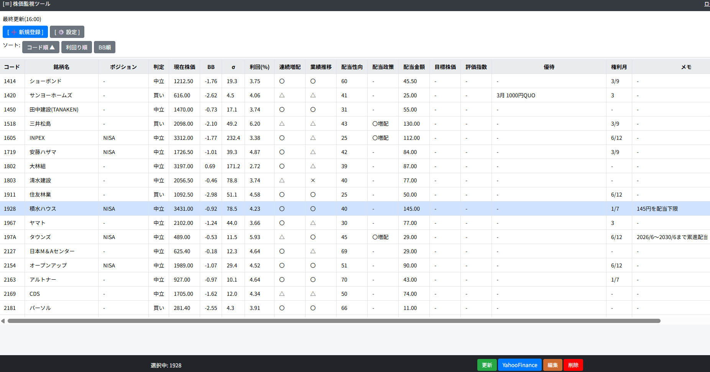

# 株価監視ツール

## 概要 (Overview)
自分用の株価監視ツール
配当を自動計算したりボリンジャーバンド位置を算出し、買い時・売り時を見つける一助とする

## 画面イメージ (ScreenShot)

## 動作要件 (Requirements)
Linux系OS / Python3（3.13.18）/ SQLite / Django

## ライセンス (License)
This software is released under the MIT License, see LICENSE.

## 手順

### 設定
$ sudo apt update
$ sudo apt install -y curl git make build-essential libssl-dev zlib1g-dev \
libbz2-dev libreadline-dev libsqlite3-dev wget curl llvm libncurses5-dev \
libncursesw5-dev xz-utils tk-dev libffi-dev liblzma-dev
$ mkdir stock_app
$ cd stock_app/
$ curl https://pyenv.run | bash
$ echo 'export PYENV_ROOT="$HOME/.pyenv"' >> ~/.bashrc
$ echo '[[ -d $PYENV_ROOT/bin ]] && export PATH="$PYENV_ROOT/bin:$PATH"' >> ~/.bashrc
$ echo 'eval "$(pyenv init -)"' >> ~/.bashrc
$ source ~/.bashrc
$ pyenv install 3.13
$ pyenv local 3.13
$ python -m venv venv
$ pip install --upgrade pip
$ pip install django
$ pip install requests

$ python --version

### SQLiteツール
- インストール
$ sudo apt update && sudo apt install -y sqlite3

- 起動
$ sqlite3 db.sqlite3

- テーブル一覧
$ .tables
% .schema stocks_stock

- SELECT
$ SELECT * FROM stocks_stock;
$ INSERT INTO stocks_stock VALUES ('2021-08-14', '交通費', 'バス代', 0, 280);

### マイグレーション
- ユーザー登録
$ python manage.py createsuperuser
- マイグレーション
$ python manage.py makemigrations
$ python manage.py migrate

### 起動
$ cd ~/stock_app/
$ source venv/bin/activate
$ cd ~/stock_app/stock_rspi
　必要な場合
$ python manage.py makemigrations
$ python manage.py migrate
　起動
$ python manage.py runserver 0.0.0.0:8000

### 定期巡回（株価の更新）
- crontabに登録する
cd /home/raspberrypi3/stock_app && /home/raspberrypi3/stock_app/venv/bin/python manage.py update_stocks --sleep 1 >> /home/raspberrypi3/stock_app/logs/update_stocks.log 2>&1

## フォルダ構成
stock_project/     <--- プロジェクトルート
│  .gitignore
│  manage.py
│  restart_server.sh
│
├─logs
│      update_stocks.log
│
├─stocks
│  │  admin.py
│  │  apps.py
│  │  forms.py
│  │  models.py
│  │  urls.py
│  │  utils.py
│  │  views.py
│  │  __init__.py
│  │
│  ├─management
│  │  └─commands
│  │          send_bb_alert.py
│  │          update_stocks.py
│  │
│  └─templates
│      └─stocks
│              login.html
│              score_settings.html
│              stock_form.html
│              stock_list.html
│
├─stock_rspi
│      asgi.py
│      settings.py
│      urls.py
│      wsgi.py
│      __init__.py
│
└─venv

## 仕様
すべてログイン必須

### サーバ
ラズベリーパイ（3 or 4）のローカルサーバを利用、一般公開はしない

### フレームワーク
Python3 / Django / SQLite

### API
url = f"https://query2.finance.yahoo.com/v8/finance/chart/{symbol_str}?range=1y&interval=1d&events=div"

### 入力 
必須：コード
任意：銘柄名、判定（ファンダメンタルズ）、ポジション、目標価格、配当金額、配当性向、連続増配、業績推移、権利月（複数設定可能）、配当政策、優待、メモ

新規で入力または内容が更新されたら、更新日を更新する

### 出力、画面表示
上部コントロールエリア：設定、新規ボタン
ソートボタン：コード、判定（ファンダメンタルズ）、利回り、BB、
銘柄選択時：更新、YahooFinance、編集ボタン
カラム（表示データ）：
コード、銘柄名、ポジション、判定（ファンダメンタルズ）、配当利回り、ボリンジャーバンド位置、σ、現在株価（最新株価） 、連続増配、業績推移、配当性向、配当政策、配当金額、 評価指数、目標株価、メモ、更新日

デフォルト出力はコード順
コード、ボリンジャーバンド位置、評価指数、配当利回りでソート機能
列方向は 「コード」「銘柄名」まで、行方向は「カラム名」でスクロール固定

クリックで行選択
選択すると行ハイライト、上部の「更新、YahooFinance、編集」ボタンが活性化または表示される
YahooFinanceは当該銘柄のYahooFinanceページへリンク

### 動き
#### 変数定義
現在価格、目標価格、配当利回り、配当金額、配当性向 、監視価格：小数
コード、評価指数、ボリンジャーバンド位置：整数
銘柄名、優待：テキスト、メモ（任意）
判定（ファンダメンタルズ）：各種入力値と配当利回りから計算して数値算出、基準に従って〇、△、[無印]で評価、〇、△にハイライト色設定　
連続増配、業績推移：〇、△、×。〇、△にハイライト色設定　 
配当政策：連続増配〇、連続非減配△、その他×、〇、△にハイライト色設定　 
連続増配、業績推移、配当政策 は入力は官能的にするが、判定計算時にはそれぞれ数値に変換する 
ポジション：ドロップダウンリスト（NISA、松井、SBI、マネックス、その他）

評価指数は別途計算式を定義する

#### 新規登録画面
「入力」項目を入力できるフォーム
銘柄名が未入力の場合はAPIから取得してセット、入力がある場合は銘柄名は変更しない 
銘柄名が特定出来たら、過去75日分の価格を取得し終値を保存（最大243件拾える） 

#### 定期更新
非公式API（Yahoo finance）でコードをもとに株価を取得
配当金額は手動更新
これらより以下の「場中更新」「終値更新」として株価、配当利回り、評価指数、ボリンジャーバンド位置、σ を更新する
配当金額が未入力の場合は0としてあつかう

#### 場中更新
9:00～15:40までは設定時間ごと（分単位）に 当日の最新価格のみ更新し、10銘柄程度ごとにコミット
銘柄毎に更新ボタン押下で更新（APIの節約のため手動更新は１銘柄毎）

#### 終値更新
16:00に本日の終値まで全部更新（洗替）、こちらも10銘柄程度ごとにコミット 
これ以降翌日9:00までは価格は更新しない

#### 新規登録時
登録された銘柄のみ過去分の株価と配当利回り、評価指数、ボリンジャーバンド位置、σ を更新する

価格推移は営業日ごとに保存、75、25日ごとにリングバッファとして上書き
（過去分が安定して取り込めるなら洗替する、安定しない場合はリングバッファで当日分のみにすることも検討）

### 評価指数
配当利回り、連続増配、業績推移、配当性向、配当政策で算出
（計算式は別途作成）

### 設定画面
#### 画面表示
配当利回りとボリンジャーバンド位置は数値水準で色分け
基準値と色を設定可能、最大５段階、それぞれ設定

#### 休日設定
パラメータとして祝日設定yyyy/mm/dd形式で設定し、営業日外では株価は保存しない（頻繁には使わないので登録は手動のみ）
登録と削除、変更が可能なフォーム

#### 場中更新周期
分単位で設定

#### メール配信時刻
hh:mmで登録

### メール送信
メールはGmailのAPIを利用
営業日の設定時刻にボリンジャーバンド位置（2σ以上と-2σ以下）で抽出したリスト（コード、銘柄名、株価、ボリンジャーバンド位置）をメール送信する
エラーとなった場合は15分後にリトライ（1回のみ）
抽出0件でも「0件の特別文面」で送信する

### その他
株式分割や併合は考慮しない（手動対応）

